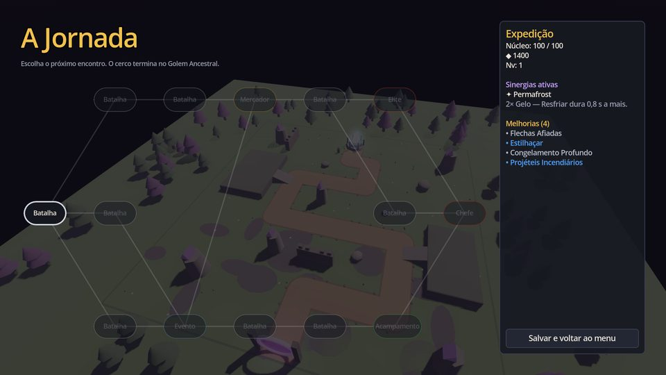
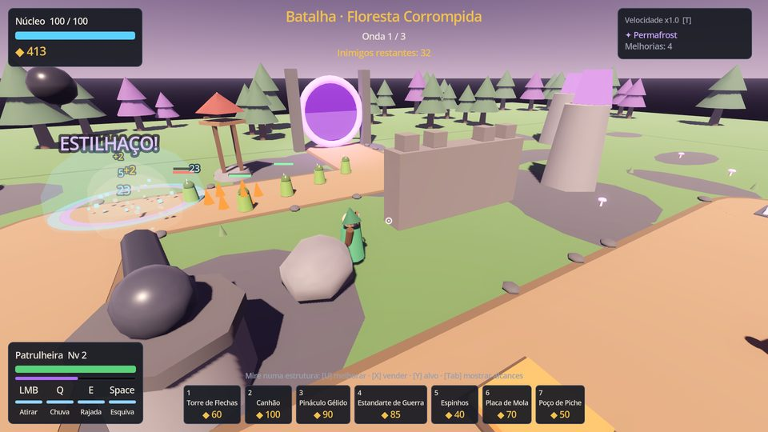
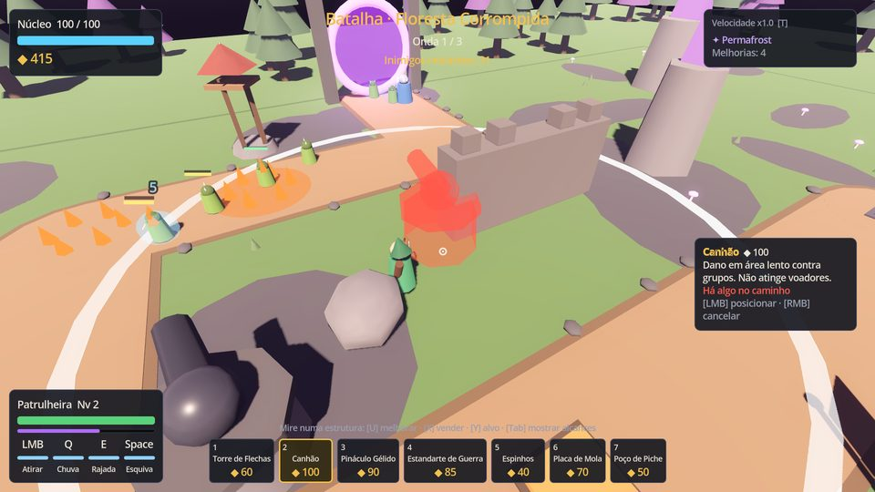
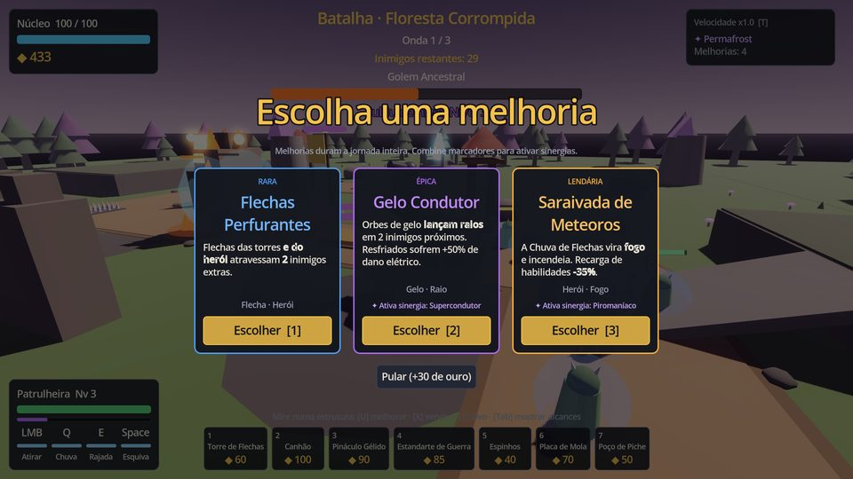
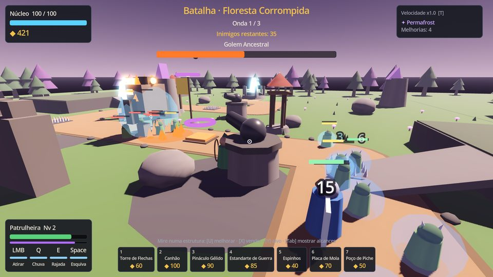
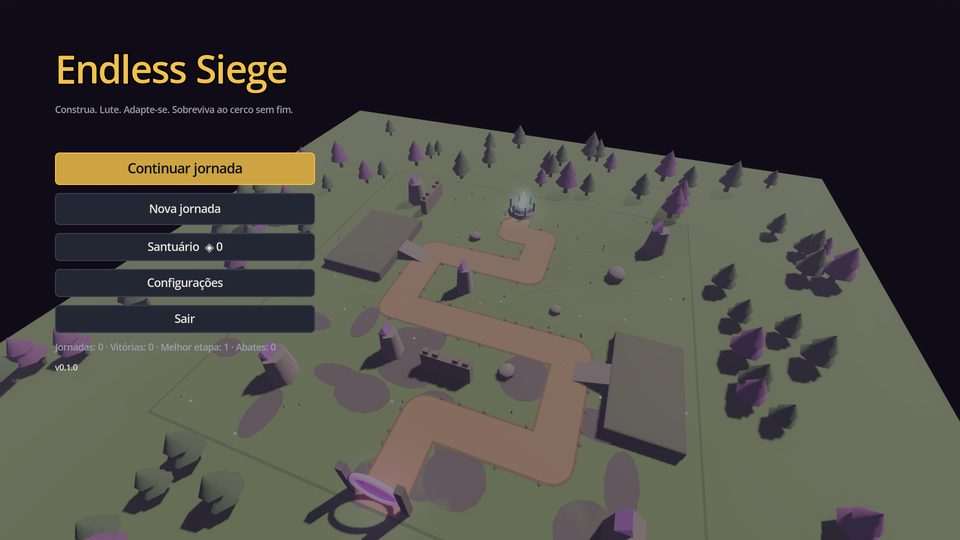

# Endless Siege

Tower defense roguelike em **3D, terceira pessoa**, para PC (Windows primeiro, Linux também; Steam Deck via Linux). Você controla uma heroína que luta ao lado das suas torres e armadilhas, avança por uma jornada ramificada de encontros e monta uma build diferente a cada tentativa, escolhendo uma de três melhorias aleatórias após cada batalha.

Feito em **Godot 4.3** (GDScript). A arte, os sons e a música são placeholders gerados por código (primitivas 3D estilizadas e áudio sintetizado), para validar a diversão do núcleo antes de investir em assets.

| Jornada | Batalha | Construção |
|---|---|---|
|  |  |  |
| **Melhorias** | **Chefe** | **Menu** |
|  |  |  |

## Escopo do MVP

| # | Item | Status |
|---|---|---|
| 1 | Um mapa funcional | ✅ Floresta Corrompida: estrada sinuosa, platôs com rampa (+20% de alcance), obstáculos que bloqueiam a linha de visão, muralhas |
| 2 | Herói controlável | ✅ Patrulheira: WASD, câmera no ombro, tiro com mira assistida, Chuva de Flechas (Q), Rajada Concussiva (E), esquiva (Espaço), interação (F), níveis na jornada |
| 3 | Três torres | ✅ Flechas, Canhão, Pináculo Gélido, mais o Estandarte de Guerra (suporte, desbloqueável) |
| 4 | Duas armadilhas | ✅ Espinhos, Placa de Mola (empurrão), mais o Poço de Piche (óleo/lentidão, desbloqueável) |
| 5 | Cinco tipos de inimigos | ✅ 7 tipos + fragmento: básico, rápido, blindado, voador, divisor, feiticeiro (desativa torres), guardião (protege aliados) |
| 6 | Um chefe | ✅ Golem Ancestral: 3 fases com pisão que desativa estruturas, invocações, armadura e fúria |
| 7 | ≥ 20 melhorias | ✅ 28 melhorias (comum, rara, épica, lendária) |
| 8 | Escolha entre três | ✅ Cartas com raridade, marcadores e aviso da sinergia que será ativada |
| 9 | Sinergias | ✅ 8 sinergias por marcadores + interações entre cartas (gelo+raio, óleo+fogo, mola+espinhos, crítico+ricochete, suporte+torres…) |
| 10 | Recursos e construção | ✅ Posicionamento livre com validação (estrada, colisão, terreno, sobreposição), melhorar ×3, vender (70%), modos de alvo |
| 11 | Ondas progressivas e derrota | ✅ Novos comportamentos por profundidade, elites, derrota quando o núcleo cai |
| 12 | Jornada com vários encontros | ✅ 7 camadas: batalha, elite, mercador, evento, acampamento e chefe; caminhos com prévia do tipo de encontro |
| 13 | Tela inicial, pausa, configurações, resultado | ✅ Inclui remapeamento de teclas, modos de janela, resolução, escala da interface, volumes, qualidade de efeitos e idioma PT/EN |
| 14 | Save e progressão permanente | ✅ Essência e desbloqueios no Santuário, desafios opcionais, jornada salva entre encontros, saves com checksum e backup |
| 15 | Partida completa do início ao fim | ✅ Coberta por testes automatizados (jornadas inteiras simuladas) e testes de cena |

O que ainda falta (arte final, áudio gravado, integração com o Steamworks, testes com jogadores, outros heróis) está em [docs/FASES.md](docs/FASES.md).

## Como jogar (desenvolvimento)

1. Instale o [Godot 4.3](https://godotengine.org/download/archive/4.3-stable/) (versão padrão, não a .NET).
2. Abra o Godot, importe o `project.godot` e pressione F5.

### Controles padrão (remapeáveis)

| Ação | Tecla | Ação | Tecla |
|---|---|---|---|
| Mover | W A S D | Escolher estrutura | 1–7 |
| Mirar / câmera | Mouse | Posicionar / cancelar | LMB / RMB |
| Atirar | LMB | Melhorar / vender / alvo (mirando a estrutura) | U / X / Y |
| Chuva de Flechas | Q | Iniciar onda | G |
| Rajada Concussiva | E | Mostrar alcances | Tab |
| Esquiva | Espaço | Velocidade do jogo (1× / 1,5× / 2×) | T |
| Interagir (suprimentos) | F | Pausa | Esc |

## Testes e ferramentas

```bash
GODOT=/caminho/godot tools/run_tests.sh             # 59 testes headless (regras, IA, cenas, input)
python3 tools/check_translations.py                 # todas as chaves de texto existem em PT/EN
godot --headless --path . --script res://tools/balance_sim.gd   # jornadas simuladas (balanceamento)
GODOT=/caminho/godot tools/export_all.sh            # builds de Windows e Linux em build/
```

O GitHub Actions (`.github/workflows/ci.yml`) roda as checagens, os testes e as exportações a cada push, e publica os builds como artefatos.

## Documentação

- [docs/ARQUITETURA.md](docs/ARQUITETURA.md): por que Godot, camadas e sistemas, dados, seeds, saves, desempenho
- [docs/DESIGN.md](docs/DESIGN.md): regras, estruturas, inimigos, chefe, melhorias, sinergias, jornada, progressão
- [docs/BALANCEAMENTO.md](docs/BALANCEAMENTO.md): método e resultados das simulações
- [docs/BUILD_E_STEAM.md](docs/BUILD_E_STEAM.md): builds de Windows e Linux, Steam Deck e publicação na Steam
- [docs/FASES.md](docs/FASES.md): fases 1 a 7, critérios de conclusão, como reproduzir e pendências
